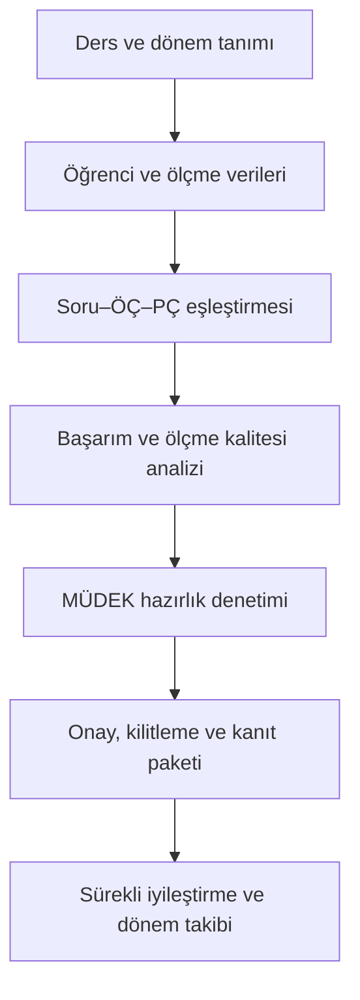

# Analytics

**Program Çıktıları, Ölçme-Değerlendirme ve MÜDEK Süreçleri İçin Analitik Destek Sistemi**

Analytics; derslerde üretilen öğrenci, sınav, soru ve not verilerini **öğrenme çıktıları (ÖÇ)** ile **program çıktıları (PÇ)** üzerinden analiz eden bir masaüstü yazılımıdır. Program, ders düzeyindeki ham ölçme verilerini program düzeyinde izlenebilir sonuçlara, kalite göstergelerine, raporlara ve denetlenebilir akreditasyon kanıtlarına dönüştürür.

Yazılımın temel amacı yalnızca PÇ başarı yüzdelerini hesaplamak değildir. Aynı zamanda bu sonuçların:

- hangi öğrenci, soru ve ölçme bileşeninden üretildiğini göstermeyi,
- ölçümün güvenilirliğini ve belirsizliğini değerlendirmeyi,
- ders ve dönemler arasındaki değişimi izlemeyi,
- düşük başarı veya yetersiz ölçme durumlarında iyileştirme kaydı oluşturmayı,
- onaylanan sonuçları değiştirilemez dönem kayıtlarına dönüştürmeyi,
- MÜDEK değerlendirmelerinde kullanılabilecek düzenli kanıt paketleri üretmeyi

amaçlar.

> **Önemli not:** PCYS Analytics, MÜDEK tarafından yayımlanmış resmî bir yazılım değildir. MÜDEK ölçme, değerlendirme, izleme ve sürekli iyileştirme süreçlerini desteklemek amacıyla geliştirilmiş bağımsız bir akademik yazılımdır. Üretilen sonuçlar, kurumun akademik değerlendirme ve karar süreçlerinin yerine geçmez.

## Programın Temel İş Akışı



Bu yapı sayesinde bir dersin ölçme verileri, veri girişinden başlayarak program çıktısı başarımına ve akreditasyon kanıtına kadar tek bir izlenebilir zincir içinde yönetilir.

## Kullanılan Temel Veriler

| Veri grubu | İçerik |
| --- | --- |
| Ders bilgileri | Ders kodu, ders adı, AKTS değeri ve aktif dönem |
| Ölçme bileşenleri | Vize, final, bütünleme, ödev ve kullanıcı tarafından tanımlanan diğer bileşenler |
| Ölçme yapısı | Bileşen ağırlıkları, soru sayıları ve tam puanlar |
| Öğrenci verileri | Öğrenci listesi, öğrenci numarası ve soru/bileşen bazlı notlar |
| Çıktı eşleştirmeleri | Soru–ÖÇ, soru–PÇ ve ÖÇ–PÇ ilişkileri |
| Başarı ölçütleri | Ders sonucu ve PÇ başarı eşikleri |
| Dolaylı ölçme | Anket maddeleri ve öğrenci değerlendirmeleri |
| Program verileri | Transkript, mezuniyet ve giriş kohortu bilgileri |
| İyileştirme kayıtları | Sorun, karar, sorumlu, hedef dönem, durum ve sonuç bilgileri |

## 1. Ders ve Dönem Yönetimi

PCYS Analytics, ölçme-değerlendirme sürecini ders ve dönem temelinde yönetir.

- Yeni ders oluşturulabilir veya daha önce kaydedilmiş bir ders açılabilir.
- Ders bilgileri ve ölçme verileri Excel dosyasından içe aktarılabilir.
- Öğrenci listesi tek ders için veya ders bazlı toplu liste biçiminde yüklenebilir.
- Vize, final, bütünleme ve ödev gibi ölçme bileşenleri tanımlanabilir.
- Her ölçme bileşeni için ağırlık, soru sayısı ve soru puanları düzenlenebilir.
- Aynı dersin farklı dönemleri ayrı kayıtlar olarak yönetilebilir.
- Ortak PÇ kataloğu kullanılarak dersler arasında tutarlı program çıktısı tanımları korunabilir.
- Ders verileri kaydedilebilir ve gerektiğinde yeniden Excel biçiminde dışa aktarılabilir.

Bu bölüm, analizde kullanılan bütün verilerin düzenli ve tekrar kullanılabilir biçimde hazırlanmasını sağlar.

## 2. ÖÇ ve PÇ Başarım Hesaplamaları

Program, sınav sorularını ilgili öğrenme ve program çıktılarıyla ilişkilendirerek öğrenci, ders ve program düzeyinde başarım hesaplar.

### Ders sonuçları ekranları

- **Öğrenciler / Notlar:** Öğrencilerin ölçme bileşeni ve toplam ders notlarını gösterir.
- **Notlar + PÇ:** Öğrenci notlarını ilgili program çıktısı katkılarıyla birlikte sunar.
- **PÇ Özeti:** Her program çıktısının ders içindeki başarı düzeyini özetler.
- **ÖÇ Başarımı:** Ders öğrenme çıktılarının gerçekleşme düzeyini hesaplar.
- **Total PÇ:** Dersin program çıktısı katkılarını bütünleşik olarak gösterir.
- **Bütünleme Kullananlar:** Final yerine bütünleme sonucu kullanılan öğrencileri ayrı olarak listeler.

Program düzeyindeki katkı hesabında ders sonucu, AKTS değeri ve dersin ilgili PÇ'ye katkısı birlikte değerlendirilir. Arayüzde kullanılan temel normalizasyon yaklaşımı aşağıdaki gibidir:

$$
\text{PÇ katkısı} =
\frac{\text{Ders sonucu} \times \text{AKTS} \times \text{Dersin PÇ katkısı}}
{\text{Toplam PÇ katkısı}}
$$

PÇ eşikleri kullanıcı tarafından düzenlenebilir ve eşik değiştiğinde sonuçlar yeniden hesaplanabilir.

## 3. MÜDEK Hazırlık Merkezi

**MÜDEK Hazırlık Merkezi**, ders veya dönem kayıtlarının değerlendirme ve kanıt üretimi açısından ne ölçüde hazır olduğunu tek ekranda gösterir.

Bu merkez:

- genel bir hazırlık puanı üretir,
- sağlanan ve sağlanmayan zorunlu kuralları gösterir,
- eksik öğrenci, ölçme, eşleştirme, analiz veya iyileştirme kayıtlarını belirler,
- ölçme kalitesi ve belge kanıtı durumunu denetler,
- her bulguyu ilgili düzeltme ekranına yönlendirir,
- onay ve kilitleme öncesinde eksiklerin tamamlanmasını destekler.

Hazırlık Merkezi'nin amacı, değerlendirme döneminde eksik belge aramak yerine açıkların veri giriş ve analiz aşamasında görülmesini sağlamaktır.

## 4. Onay, Revizyon ve Dönem Kilitleme

Program, sonuçların kontrollü biçimde değerlendirilmesi için rol tabanlı bir onay süreci uygular:

1. **Ders sorumlusu gönderir.**
2. **Program veya bölüm koordinatörü onaylar.**
3. **İlgili komisyon onaylar.**
4. **Dönem kilitlenir.**

Süreçte kullanılan temel durumlar şunlardır:

```text
Taslak → Ders Sorumlusu Gönderdi → Koordinatör Onayladı
       → Komisyon Onayladı → Kilitli
```

Kilitleme işlemi sırasında:

- MÜDEK hazırlık durumu yeniden kontrol edilir,
- zorunlu kurallarda açık varsa kilitleme engellenir,
- döneme ait değiştirilemez bir sonuç anlık görüntüsü oluşturulur,
- kayda bir revizyon numarası atanır,
- bütünlük denetimi için SHA-256 özeti üretilir,
- onaylayan kullanıcı, rol, işlem ve tarih bilgileri kayıt altına alınır.

Daha sonra değişiklik yapılması gerektiğinde mevcut kilitli sonuç değiştirilmez; yeni bir revizyon başlatılır. Böylece geçmiş kararlar ve sonuçlar korunur.

## 5. Sonuç Kaynağı ve İzlenebilirlik

**Sonuç Kaynağı** modülü, “Bu PÇ sonucu nereden geldi?” sorusunu yanıtlamak için tasarlanmıştır.

Kullanıcı bir PÇ ve öğrenci seçerek:

- sonuca katkı veren ölçme bileşenlerini,
- ilgili soruları,
- soru–ÖÇ–PÇ eşleştirmelerini,
- kullanılan ağırlıkları,
- öğrenci puanlarını ve hesaplama adımlarını

inceleyebilir. Bu özellik, yalnızca nihai başarı yüzdesini göstermek yerine hesaplamanın kaynağına inilmesini ve sonuçların denetlenebilmesini sağlar.

## 6. Ölçme Kalitesi ve Belirsizlik Analizi

PCYS Analytics, yüksek bir PÇ başarı değerinin tek başına yeterli olmadığını kabul eder. Başarım kararı ile ölçme kalitesini ayrı değerlendirir.

### Belirsizlik ve güvenilirlik çıktıları

- PÇ bazında ölçme belirsizliği tablosu
- Bootstrap yöntemiyle güven aralıkları
- Belirlenen başarı eşiğini geçme olasılığı
- Cronbach alfa güvenirlik katsayısı
- Ölçmenin standart hatası (SEM)
- Hedef güvenirlik için önerilen soru sayısı
- Etkin bağımsız çıktı sayısı (`n_eff`)
- Marjinal ve eşzamanlı güven aralıklarının karşılaştırılması
- PÇ korelasyon grafı ve korelasyon matrisi
- Birbirinden yeterince ayrı ölçülemeyen PÇ grupları
- Ölçme tasarımını geliştirmek için soru ekleme önerileri

Bu analizler, bir PÇ'nin yalnızca eşiği geçip geçmediğini değil, bu kararın ne kadar güvenilir olduğunu da değerlendirmeye yardımcı olur.

### Genellenebilirlik Kuramı ve D-Çalışması

**G-Teorisi** analizi, öğrenci ve soru kaynaklı varyans bileşenlerini ayırarak ölçme sonuçlarının genellenebilirliğini inceler. **D-Çalışması** ise farklı soru sayılarında beklenen ölçme kalitesini değerlendirir. Böylece kullanıcı, belirli bir PÇ için kullanılan soru sayısının yeterli olup olmadığını daha sistematik biçimde inceleyebilir.

### Madde analizi ve IRT

Gelişmiş analiz modülü:

- klasik madde analizi,
- soru güçlüğü ve ayırt ediciliği,
- IRT/Rasch veya 2PL tabanlı kestirimler,
- öğrenci yeteneği (`θ`) kestirimi,
- farklı dönemlerin ortak bir ölçek üzerinde karşılaştırılmasına yönelik dönem bağlama

işlevlerini içerir.

## 7. Doğrudan ve Dolaylı Ölçme

Program, sınav ve ödev gibi **doğrudan ölçme** sonuçları ile anketlerden elde edilen **dolaylı ölçme** sonuçlarını birlikte değerlendirebilir.

- Anket maddeleri programa yüklenebilir.
- Anket maddeleri ilgili PÇ'lerle eşleştirilebilir.
- Doğrudan ve dolaylı ölçme sonuçları karşılaştırılabilir.
- İki ölçme türü arasındaki belirgin farklılıklar görülebilir.

Bu karşılaştırma, öğrencilerin kendi algılarıyla ölçülen akademik performans arasındaki uyumun değerlendirilmesini destekler.

## 8. ÖÇ–PÇ Geçerlik ve Kapsama Analizi

Yazılım, **soru → ÖÇ → PÇ** zincirini denetleyerek ölçme tasarımındaki eksik veya tutarsız ilişkileri belirlemeye yardımcı olur.

### Geçerlik denetimi

- Soru–ÖÇ ve ÖÇ–PÇ eşleştirmelerinin tutarlılığını kontrol eder.
- Her ÖÇ'nin hangi PÇ'lere katkı verdiğini gösterir.
- ÖÇ başarı özetlerini PÇ sonuçlarıyla birlikte değerlendirir.

### Kapsama topolojisi

- Ders × PÇ kapsama yapısını analiz eder.
- Ölçülmeyen PÇ'leri belirler.
- Program içinde aşırı yük taşıyan darboğaz dersleri gösterir.
- Hiçbir ölçmede birlikte ele alınmayan PÇ çiftlerini listeler.
- Kapsama boşluklarını ve gereksiz tekrarları görünür hâle getirir.
- Hodge spektrumu gibi ileri topolojik özetler üretebilir.

Bu bölüm özellikle müfredatın program çıktıları açısından dengeli olup olmadığını incelemek için kullanılabilir.

## 9. Dönem, Kohort ve Transkript Takibi

Tek bir ders veya tek bir dönem sonucu, programın uzun dönemli gelişimini göstermeye yetmez. Bu nedenle PCYS Analytics çok dönemli izleme araçları sunar.

- PÇ başarılarının dönemler arasındaki değişimini gösterir.
- Dönemler arası fark analizleri üretir.
- Öğrencileri giriş kohortlarına göre izler.
- Kohort × PÇ matrisi oluşturur.
- Giriş kohortlarının program çıktısı gelişimini uzunlamasına değerlendirir.
- Transkript verilerini ders ve öğrenci düzeyinde işler.
- Ders sonuçlarını program PÇ özetine birleştirir.

Bu yapı, tek dönemlik başarı dalgalanmaları ile kalıcı gelişim veya gerileme eğilimlerinin birbirinden ayrılmasına yardımcı olur.

## 10. Sürekli İyileştirme

PCYS Analytics, düşük veya güvenilirliği yetersiz PÇ sonuçlarını yalnızca raporlamakla kalmaz; bunların izlenebilir iyileştirme kayıtlarına dönüştürülmesini sağlar.

Her kayıt aşağıdaki zinciri içerir:

```text
Tespit edilen sorun → Alınan karar → Sorumlu kişi
                     → Hedef dönem → Uygulama durumu → Sonuç
```

Sürekli iyileştirme modülü:

- yeni iyileştirme kaydı oluşturur,
- analizde belirlenen sorunlu PÇ'ler için taslak önerir,
- sorumlu kişi ve hedef dönem tanımlanmasını sağlar,
- işlemi “Planlandı”, “Uygulanıyor”, “Tamamlandı” veya “İptal” durumlarıyla izler,
- alınan kararın sonraki dönemdeki etkisini analiz eder,
- kayıtları Excel'e aktarır,
- teslim öncesinde sağlık kontrolü ve tutarsızlık listesi üretir.

Bu sayede sürekli iyileştirme, yalnızca açıklama metni olmaktan çıkarak kanıtlanabilir bir karar ve etki döngüsüne dönüştürülür.

## 11. Bölüm ve Program Düzeyi Görünümler

Bölüm koordinatörü görünümü, farklı derslerden gelen sonuçların program düzeyinde birlikte değerlendirilmesini sağlar.

- Derslerin veri, analiz ve onay durumlarını özetler.
- Ders sorumlusunun beyanı ile ölçülen PÇ katkısını karşılaştırır.
- Program düzeyindeki PÇ beyanlarını toplu olarak gösterir.
- Ders × PÇ katkı matrisini üretir.
- Müfredat boşluklarını ve gereksiz tekrarları belirlemeye yardımcı olur.
- Program çıktılarını birden fazla ders ve dönem üzerinden birleştirir.

Bu görünüm, ders sorumlularının ayrıntılı verileri ile bölüm yönetiminin ihtiyaç duyduğu program düzeyi özetler arasında bağlantı kurar.

## 12. Grafikler ve Raporlama

Analiz sonuçları tablo ve grafikler üzerinden incelenebilir. Program aşağıdaki dışa aktarma seçeneklerini sunar:

| Çıktı | Açıklama |
| --- | --- |
| Excel raporu | Sonuçları ve analiz tablolarını çok sayfalı çalışma kitabı olarak kaydeder. |
| PDF raporu | Ders, PÇ, ölçme kalitesi ve değerlendirme sonuçlarını rapor biçiminde sunar. |
| JPEG grafikler | Üretilen analiz grafiklerini ayrı görsel dosyalar olarak dışa aktarır. |
| Tümünü dışa aktar | Raporları, tabloları ve grafikleri tek işlemle üretir. |
| Dönem sonu ders dosyası | Bir dersin dönem sonunda ihtiyaç duyulan temel kayıtlarını düzenli klasör yapısında toplar. |
| Akreditasyon klasörü | Ders kanıtlarını, program çıktılarını, iyileştirme kayıtlarını, kohort analizlerini ve onay kayıtlarını bir araya getirir. |

## 13. MÜDEK Kanıt Paketleri

Program iki farklı kanıt paketi oluşturabilir:

### Denetlenebilir kanıt paketi

Tam veri, analiz, yöntem, grafik, rapor ve izlenebilirlik kayıtlarını içerir. Kurum içi kontrol veya yetkilendirilmiş değerlendirme sürecinde kullanılabilir.

### Anonim kanıt paketi

Öğrenci kimlik bilgilerini anonimleştirerek analiz yapısını ve sonuçların denetlenebilirliğini korur. Kişisel verilerin paylaşılmaması gereken inceleme durumları için uygundur.

### Paket bütünlüğü

Kanıt paketlerinde:

- uygulama ve hesaplama sürümü,
- dönem ve ders bilgileri,
- yöntem özeti,
- analiz ve rapor dosyaları,
- dosya listesi içeren manifest,
- dosyaların SHA-256 bütünlük özetleri,
- paket imzası ve doğrulama bilgileri

bulunur. **Kanıt Paketi Bütünlüğünü Doğrula** işlevi, paket oluşturulduktan sonra içeriğin değiştirilip değiştirilmediğini kontrol eder.

## 14. Araştırma ve İleri Analitik Araçları

Standart MÜDEK iş akışına ek olarak programda araştırma ve yöntem geliştirme amacıyla kullanılabilecek ileri modüller de bulunur:

- karar kararlılığı analizi,
- “what-if” ve politika simülasyonu,
- sonuç kaynağı ağacı,
- ölçme planı ve Bloom düzeyi analizi,
- ders–PÇ ilişki haritası,
- müfredat boşluk ve tekrar analizi,
- simülatör üzerinde eğitilen GNN tabanlı amortize çıkarım,
- model kalibrasyonu ve gerçek veri doğrulaması,
- değerlendirici için salt okunur inceleme modu.

Bu araçlar temel PÇ hesabı için zorunlu değildir; ileri ölçme analitiği, araştırma veya kurumsal karar desteği için kullanılır.

## Üretilen Başlıca Sonuçlar

- Öğrenci ve ders başarı tabloları
- ÖÇ ve PÇ başarım yüzdeleri
- Ağırlıklı ve toplam PÇ katkıları
- Bütünleme kullanım kayıtları
- PÇ eşik durumu ve hazırlık puanı
- Ölçme belirsizliği ve güven aralıkları
- Güvenirlik ve madde analizi sonuçları
- Doğrudan–dolaylı ölçme karşılaştırmaları
- Dönem ve kohort eğilimleri
- Sürekli iyileştirme ve etki kayıtları
- Onay geçmişi ve kilitli dönem anlık görüntüleri
- Excel, PDF ve JPEG raporları
- Doğrulanabilir veya anonim MÜDEK kanıt paketleri

## Hedef Kullanıcılar

PCYS Analytics aşağıdaki kullanıcı grupları için tasarlanmıştır:

- ders sorumluları,
- bölüm ve program koordinatörleri,
- ölçme-değerlendirme komisyonları,
- kalite ve akreditasyon komisyonları,
- bölüm yönetimleri,
- program çıktılarını araştırma amacıyla inceleyen akademisyenler.

## Tipik Kullanım Senaryosu

1. Ders ve dönem oluşturulur.
2. Öğrenci listesi ve not verileri yüklenir.
3. Ölçme bileşenleri ile soru–ÖÇ–PÇ eşleştirmeleri tanımlanır.
4. Başarı eşikleri belirlenir ve analiz çalıştırılır.
5. Ders, ÖÇ ve PÇ sonuçları incelenir.
6. Ölçme kalitesi, belirsizlik ve geçerlik kontrolleri yapılır.
7. MÜDEK Hazırlık Merkezi'ndeki eksikler giderilir.
8. Gerekli iyileştirme kayıtları oluşturulur.
9. Ders sorumlusu, koordinatör ve komisyon onayları tamamlanır.
10. Dönem kilitlenir ve kanıt paketi üretilir.
11. Sonraki dönemde alınan kararların etkisi izlenir.

## Kullanımda Dikkat Edilmesi Gerekenler

- Analizlerin doğruluğu, girilen notların ve ÖÇ–PÇ eşleştirmelerinin doğruluğuna bağlıdır.
- Başarı eşikleri kurum veya program tarafından akademik gerekçeyle belirlenmelidir.
- İstatistiksel sonuçlar bağlamından bağımsız ve tek başına karar ölçütü olarak kullanılmamalıdır.
- Yazılımın ürettiği hazırlık puanı veya kanıt paketi, bir programın MÜDEK tarafından akredite edileceği anlamına gelmez.
- Kurumun veri koruma, kişisel veri ve yetkilendirme kuralları ayrıca uygulanmalıdır.
- Nihai akademik değerlendirme ve iyileştirme kararları yetkili kurul ve komisyonlar tarafından verilmelidir.

---

**PCYS Analytics**, ders düzeyindeki ölçme verisini program çıktısı başarımına; program çıktısı başarımını ise izlenebilir, doğrulanabilir ve sürekli iyileştirmeye bağlı bir kalite yönetimi sürecine dönüştürmeyi hedefler.
